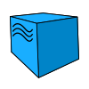
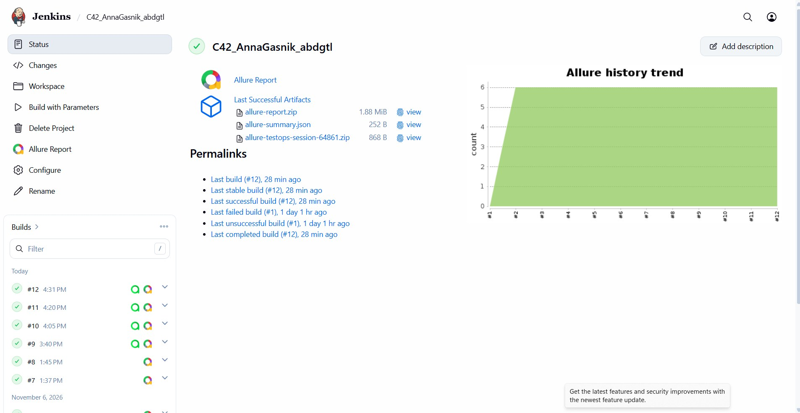
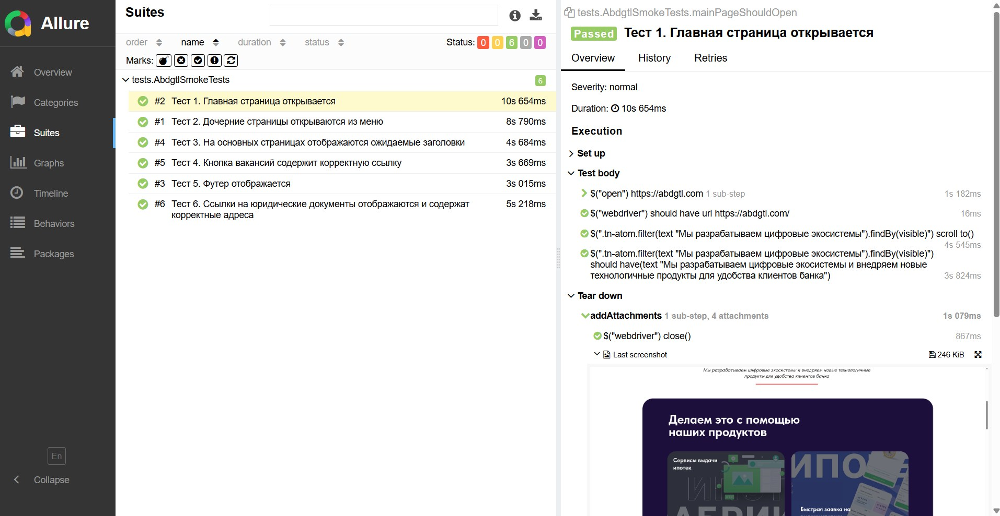
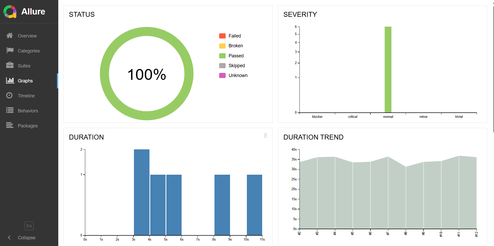
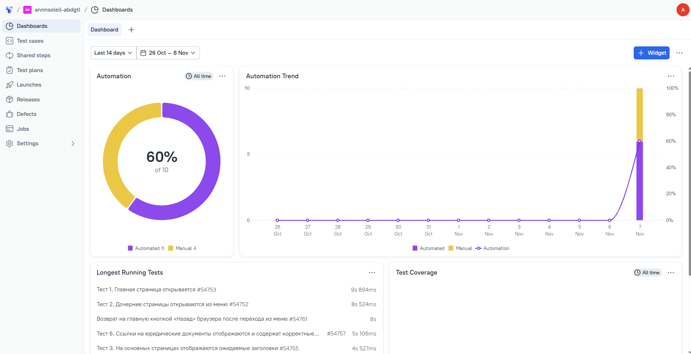
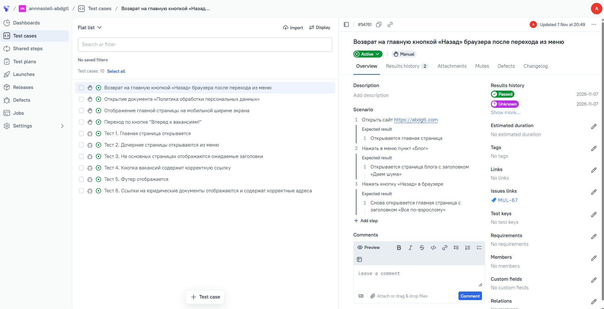
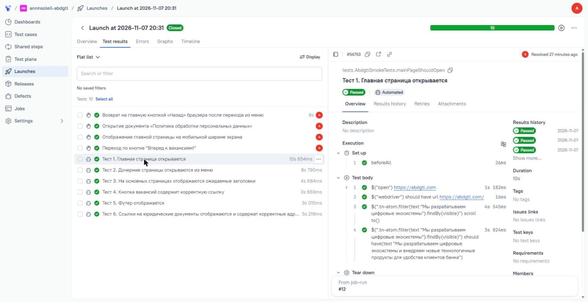
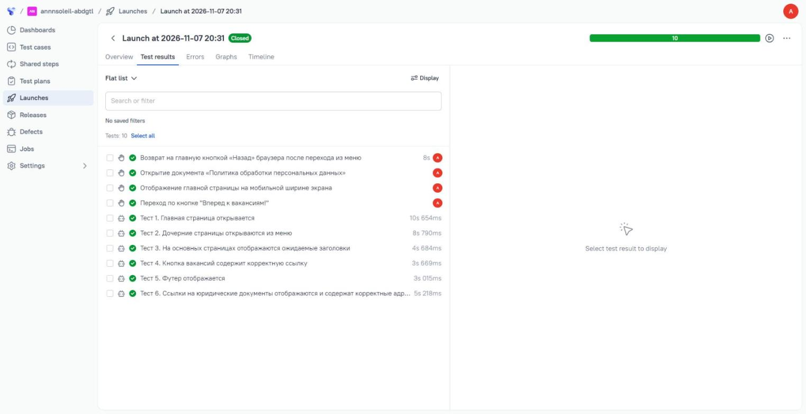
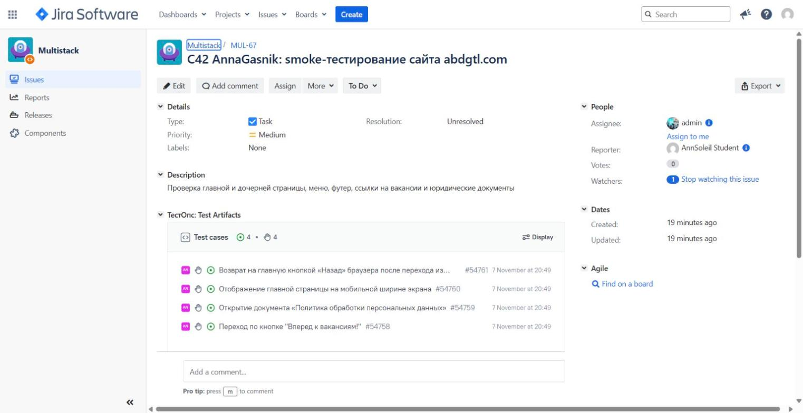
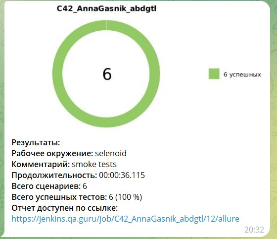

# Автотесты для сайта [AB Digital](https://abdgtl.com)

UI-автотесты на Java с запуском в Jenkins, отчётами Allure, тест-менеджментом
в Allure TestOps, связью с Jira и уведомлениями в Telegram.

## Содержание

- [Технологии и инструменты](#технологии-и-инструменты)
- [Что проверяется](#что-проверяется)
- [Запуск из терминала](#запуск-из-терминала)
- [Сборка в Jenkins](#сборка-в-jenkins)
- [Отчёт Allure](#отчёт-allure)
- [Allure TestOps](#allure-testops)
- [Интеграция с Jira](#интеграция-с-jira)
- [Уведомления в Telegram](#уведомления-в-telegram)
- [Видео прогона в Selenoid](#видео-прогона-в-selenoid)

## Технологии и инструменты

<p align="center">
<a href="https://www.jetbrains.com/idea/"></a>
<a href="https://www.java.com/"></a>
<a href="https://github.com/"></a>
<a href="https://junit.org/junit5/"></a>
<a href="https://gradle.org/"></a>
<a href="https://selenide.org/"></a>
<a href="https://aerokube.com/selenoid/"></a>
<a href="https://github.com/allure-framework/allure2"></a>
<a href="https://qameta.io/"></a>
<a href="https://www.jenkins.io/"></a>
<a href="https://www.atlassian.com/software/jira"></a>
<a href="https://telegram.org/"></a>
</p>

- Тесты написаны на **Java** с **Selenide** и **JUnit 5**, сборщик **Gradle**.
- Архитектура: **PageObject** и компоненты (шапка и футер сайта).
- Удалённо тесты запускаются в **Selenoid**, сборка в **Jenkins**.
- После каждого теста в отчёт **Allure** прикладываются скриншот, код страницы,
  логи браузера и видео.
- Ручные и автоматические тест-кейсы собраны в **Allure TestOps**, ручные связаны
  с задачей в **Jira**.
- После сборки бот присылает результаты в **Telegram**.

## Что проверяется

**Автоматические тесты**

- открытие главной страницы
- переход на дочерние страницы через меню
- заголовки основных страниц
- ссылки кнопок вакансий
- контакты в футере
- ссылки на юридические документы

**Ручные тесты**

- переход по кнопке «Вперёд к вакансиям!»
- открытие документа «Политика обработки персональных данных»
- отображение главной страницы на мобильной ширине экрана
- возврат на главную кнопкой «Назад» браузера

## Запуск из терминала

Локальный запуск в браузере на компьютере:

```bash
./gradlew clean test
```

Удалённый запуск в Selenoid:

```bash
./gradlew clean test \
  "-DBASE_URL=https://abdgtl.com" \
  "-DBROWSER=chrome" \
  "-DBROWSER_SIZE=1920x1080" \
  "-DREMOTE_URL=<адрес Selenoid>" \
  "-DREMOTE_LOGIN=<логин>" \
  "-DREMOTE_PASSWORD=<пароль>"
```

Открыть отчёт Allure после прогона:

```bash
./gradlew allureServe
```

### Параметры запуска

| Ключ | Что задаёт | По умолчанию |
|---|---|---|
| `BASE_URL` | адрес тестируемого сайта | `https://abdgtl.com` |
| `BROWSER` | браузер | `chrome` |
| `BROWSER_SIZE` | размер окна браузера | `1920x1080` |
| `REMOTE_URL` | адрес Selenoid без `https://`; если не задан, тесты идут локально | — |
| `REMOTE_LOGIN` | логин для Selenoid | — |
| `REMOTE_PASSWORD` | пароль для Selenoid | — |

Логин и пароль не хранятся в коде: их передают при запуске, а в Jenkins они
задаются в настройках сборки.

## Сборка в Jenkins

Сборка запускается кнопкой **Build with Parameters**. После неё формируется отчёт
Allure, результаты отправляются в Allure TestOps и приходит уведомление в Telegram.

<p align="center">

</p>

### Параметры сборки

- `REMOTE_URL`: адрес Selenoid
- `REMOTE_LOGIN`: логин для Selenoid
- `REMOTE_PASSWORD`: пароль для Selenoid (скрытый параметр)
- `TELEGRAM_TOKEN`: токен бота для уведомлений (скрытый параметр)

Остальные настройки (`BASE_URL`, `BROWSER`, `BROWSER_SIZE`) берутся по умолчанию.

## Отчёт Allure

### Тесты, шаги и вложения

Каждый шаг теста записан в отчёт. В конце теста прикладываются скриншот,
код страницы, логи браузера и видео.

<p align="center">

</p>

### Графики

<p align="center">

</p>

## Allure TestOps

### Дашборд

6 автоматических и 4 ручных теста, автоматизация 60 %.

<p align="center">

</p>

### Ручной тест-кейс

Шаги с ожидаемым результатом и связь с задачей в Jira.

<p align="center">

</p>

### Автоматический тест

Шаги подтягиваются из кода автоматически.

<p align="center">

</p>

### Запуск тест-плана

В одном запуске ручные и автоматические тесты: автотесты запускаются из TestOps
через Jenkins, результаты ручных отмечаются вручную.

<p align="center">

</p>

## Интеграция с Jira

Ручные тест-кейсы связаны с задачей и видны прямо на её странице.

<p align="center">

</p>

## Уведомления в Telegram

После сборки бот присылает результаты прогона и ссылку на отчёт.

<p align="center">

</p>

## Видео прогона в Selenoid

<p align="center">

</p>
